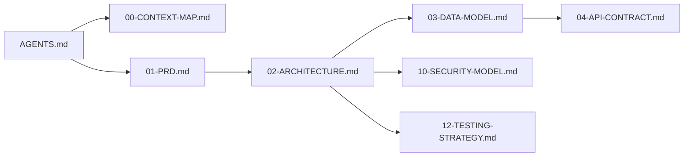

# MD-Structure: 5-Phase Agent Execution Protocol

This reference defines the exact machine-to-machine handshake between an AI coding agent and `MD-Structure`.

## Phase 1 — Structured Intake & Discovery

| Input State | Agent Action | Tool / Command |
| :--- | :--- | :--- |
| Brief / ambiguous user idea | Detect open architectural dimensions | `md_discovery_questions` / `md-structure discover "<idea>" --json` |
| Detailed idea or Intake Profile JSON | Skip directly to Phase 2 | `md_analyze_idea` / `md-structure analyze --profile intake.json --json` |

**Rule:** Never ask the user low-impact stylistic questions during Discovery. Only clarify dimensions that add or remove Markdown contract files (archetype, tier, auth/tenancy, high-risk capabilities, sync/offline model, stack constraints).

## Phase 2 — Blueprint Reasoning ("How Many / Which / Why")

The blueprint JSON returns:
- `summary.totalDocuments`: Exact count of active MDs.
- `summary.tokenLedger`: Always-on footprint vs. progressive-disclosure total budget.
- `documents[]`: Ordered topologically by `dependsOn`. Each entry carries `selectionReasons`, `whyRequired`, `failureModePrevented`, `loadPolicy`, `readTriggers`, and `tokenBudget`.
- `excludedDocuments[]`: Every omitted catalog archetype with its explicit `skipReason`.

**Rule:** Present the blueprint to the user clearly before scaffolding so scope boundaries and exclusions are mutually agreed upon.

## Phase 3 — Deterministic Scaffolding

Invoke `md_scaffold_project` or `md-structure init ... --out <dir> --json`.
- Always use `--dry-run` first if scaffolding into an existing non-empty repository.
- Use `--shims claude,cursor` (or `copilot`, `windsurf`) when the user works across multiple agent harnesses; shims stay under 15 lines and delegate to `AGENTS.md`.

## Phase 4 — Topological DAG Authoring

Authoring in DAG order guarantees zero downstream contradictions:

For each iteration of `md_next_doc`:
1. Read `next.upstreamToReadFirst` in full.
2. Fill every `<!-- AGENT:FILL -->` directive in `next.path`.
3. Prefer compact tables, Mermaid diagrams, JSON envelopes, and numbered invariants over narrative paragraphs.
4. Confirm token count <= `next.tokenBudget.max`.
5. Update frontmatter `status: draft` -> `status: approved`.

## Phase 5 — Audit & Anti-Drift Maintenance

Run `md_audit_workspace` / `md-structure audit --strict --json`:
- **Pre-code gate:** Require `readyForImplementation: true` (exit code `0`).
- **During implementation:** Load ONLY the docs whose `read_triggers` match the current task.
- **Post-change sync:** When a code change alters an authority boundary, update the owning MD in the same commit and re-run `audit`.
